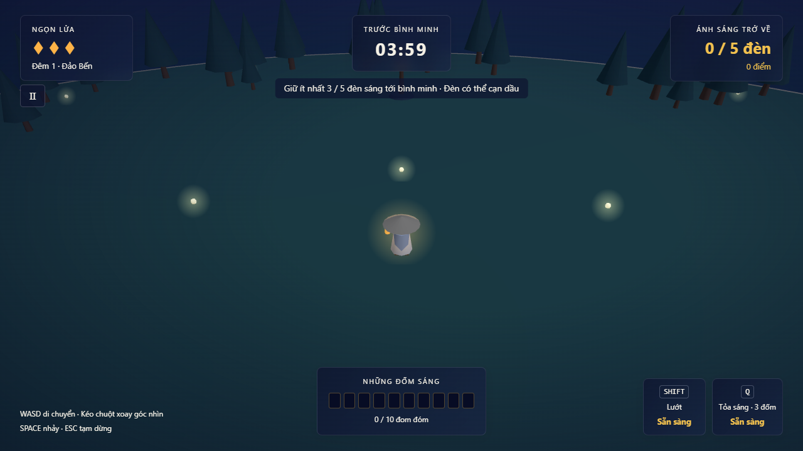

# Đảo Đèn Lồng

Game 3D góc nhìn thứ ba: cùng Mây gom đom đóm, thắp đèn và giữ ánh sáng qua **Đảo Bến → Đảo Cau → Đảo Chuông → Bình Minh**. Bản **Phase 3 / Test Contract v1.2**: giữ đảo sáng tới bình minh. Các bản trước giữ nguyên ở tag `phase-1`, `phase-2`.



## Chạy game (Python 3.10+)

```sh
python3 -m pip install -r requirements.txt
python3 tools/serve.py
```

Mở **http://127.0.0.1:8000** bằng Chrome, Edge hoặc Firefox có WebGL. Windows có thể thay `python3` bằng `python`. Three.js được lưu sẵn trong repo, không cần CDN khi chơi. macOS/Linux chạy cùng các lệnh trên; môi trường chưa có wheel QuickJS cần C compiler để pip biên dịch.

WASD / phím mũi tên di chuyển; Space nhảy; **Shift lướt**; kéo chuột xoay camera; cuộn chuột thu phóng; E nạp ánh sáng; Q tỏa sáng; Esc/P tạm dừng. Pause có Tiếp tục / Chơi lại Đêm / Cài đặt / Về menu. Âm lượng và độ nhạy chuột lưu qua lần mở sau.

Đêm1 có5đèn; Đêm2 có6đèn, cầu tre, bục nhảy, Gió Lạc và Bùa Gió; Đêm3 có7đèn, ba tầng, dốc, tháp chuông và gió định kỳ. Bùa giúp chạy7.2m/s và lướt không hồi trong10s. Gió Lạc cướp ánh sáng: tỏa sáng để đuổi hoặc lấy lại đồ bị cướp.

## Kiểm chứng và headless

```sh
python3 tools/verify.py --phase phase-3
python3 tools/headless.py --seed 42 --night 1 --ticks 600 --out artifacts/run.jsonl
```

Tùy chọn: `--night 1|2|3`, `--scenario file.json`, `--inputs file.json`, `--snapshot-every 10`. Gameplay dùng cùng `src/core.js` trên trình duyệt và QuickJS; headless không khởi động trình duyệt/GPU. Khai báo lệnh và tuning ở [game.contract.json](game.contract.json). Mã lỗi scenario/input sai là2; output JSONL luôn kết thúc bằng dòng `end` khi chạy thành công.

**Luật Phase3:** không thắng sớm. Sống tới bình minh và giữ ít nhất **3/5, 4/6, 5/7** đèn sáng ở Đêm1/2/3 để thắng (240/270/300s). Dầu tối đa100, hao1/s; E châm10 dầu mỗi đom đóm. Đèn hết dầu tắt, thắp lại cần5 đom đóm. Dưới30 dầu mất vùng an toàn và có thể bị Bóng Mực hút5/s. Sức chứa tăng2 mỗi lần thắp/thắp lại, tối đa20.

Điểm: +5/đom đóm nạp hoặc châm; +100/thắp đầu, +40/thắp lại; pulse +5/Bóng thường hoặc tổng+15/Bóng đang hút. Khi thắng, mỗi đèn đang sáng thêm50+floor(dầu), mỗi Ngọn Lửa50; không thưởng thời gian. Tổng hành trình chỉ cộng Đêm đã thắng, thua chơi lại đúng Đêm.

Trong cài đặt, bật **Bảng màu dễ phân biệt** để đổi viền/mắt Bóng sang xanh lam, cảnh báo trắng kèm⚠. Đèn tắt xẹp20% và có giấy rách; đèn yếu và thanh dầu nhấp nháy1Hz. Tùy chọn được lưu qua reload.

- [Yêu cầu gốc Phase 1](docs/requirements/phase-1.txt)
- [Ticket-02](docs/requirements/phase-2.txt) và [bảng số/màu chuẩn](docs/requirements/phase-2-standard.md)
- [Spec, giả định và tiêu chí nghiệm thu](docs/spec.md)
- [Bằng chứng Phase 1](docs/proof/phase-1/report.json)
- [Bằng chứng Phase 2](docs/proof/phase-2/report.json) · [GUI và FPS](docs/proof/phase-2/browser.json)
- [Ticket-03](docs/requirements/phase-3.md) · [ADR-003](docs/adr/003-fuel-and-dawn.md) · [Breaking changes và test được thay](CHANGELOG.md)
- [Bằng chứng Phase3](docs/proof/phase-3/report.json) · [GUI/FPS/mù màu](docs/proof/phase-3/browser.json)
- [Nhật ký AI](docs/ai-log.md)
- [Hướng dẫn lab gốc](docs/LAB-README.md)

## Sáng tạo của tôi

Mỗi đèn thức dậy có quầng sáng vàng và vòng sáng trên mặt đất; bầu trời sao, biển mây, Ông Đăng kể chuyện và nhạc được tổng hợp bằng Web Audio. Các chi tiết trang trí chỉ tồn tại trong renderer, không thay đổi output headless. Cây trang trí không có va chạm để không thêm chướng ngại ngoài bản đồ.

Nguồn và giấy phép ở [CREDITS.md](CREDITS.md), [LICENSE](LICENSE). CI được cấu hình chạy regression trên macOS/Linux; trạng thái CI chỉ xác nhận sau khi push và workflow chạy thật.

Đóng gói bản web local: `python3 tools/package.py --phase phase-3`; file ZIP trong `artifacts/`. Giải nén, chạy `python3 tools/serve.py`, mở địa chỉ in ra. Bản web chỉ cần Python chuẩn để phục vụ file; QuickJS chỉ cần cho headless/test. Chưa phát hành `v1.0.0` vì thuộc bàn giao Phase4.

Browser QA tùy chọn: cài `requirements-dev.txt`, có Chrome (hoặc đặt `CHROME_BIN`), chạy `python3 tools/browser_check.py --phase phase-3`. Kiểm tra ZIP sạch: `python3 tools/package_check.py` sau khi đóng gói. Báo cáo GUI phân biệt các scenario QA dựng sẵn với một lượt chơi toàn màn; chưa có video demo Phase4.
