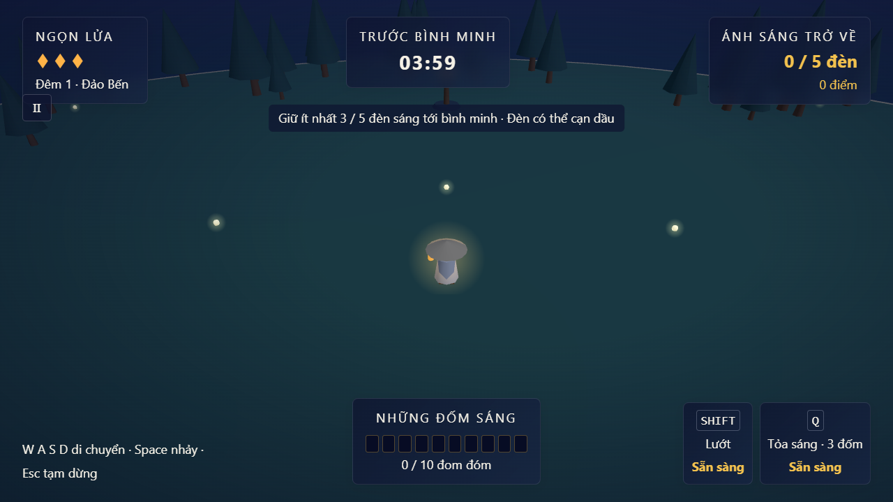

[Video demo MP4 (<5 phút)](docs/demo/demo.mp4) · [Release v1.0.0](https://github.com/BinhTa2004/K5-L3A-DAY12-TaCongBinh-2A202603628-AI-SDLC-Dao-Den-Long/releases/tag/v1.0.0)

# Đảo Đèn Lồng · v1.0.0

Game 3D góc nhìn thứ ba: cùng Mây gom đom đóm, châm dầu và **giữ đảo sáng tới bình minh** qua Đảo Bến, Đảo Cau và Đảo Chuông. Test Contract **1.3**; các mốc trước giữ nguyên ở tag `phase-1`, `phase-2`, `phase-3`.



## Yêu cầu và chạy game

Windows/macOS/Linux, Python **3.10+**, Chrome/Edge/Chromium có WebGL và màn hình khuyến nghị1280×720. Bản web, asset và Three.js được lưu sẵn trong repo; chơi không cần npm, CDN hay pip. Sau khi clone sạch, dùng **2 lệnh**:

```sh
cd K5-L3A-DAY12-TaCongBinh-2A202603628-AI-SDLC-Dao-Den-Long
python3 tools/serve.py
```

Mở **http://127.0.0.1:8000**. Trên Windows thay `python3` bằng `python` nếu cần. ReleaseZIP giải nén rồi chạy `python3 tools/serve.py`. Dữ liệu người chơi ở `artifacts/user-data/leaderboard.json`, không nằm trong Git; giữ thư mục này để bảo toàn điểm sau các lần mở lại. Có thể chọn thư mục bằng `--data-dir <dir>`.

## Chơi và cài đặt

| Mặc định | Hành động |
|---|---|
| WASD / mũi tên | Di chuyển |
| Space | Nhảy |
| Shift | Lướt |
| E | Nạp ánh sáng/châm dầu |
| Q | Tỏa sáng (tốn3đom đóm) |
| Esc / P | Tạm dừng |
| Kéo chuột / cuộn | Xoay camera / thu phóng |

Cài đặt cho đổi cả9phím hành động, báo phím trùng và khôi phục mặc định; các alias mũi tên/P/Shiftphải chỉ dùng khi không xung đột. Có âm lượng, độ nhạy, bảng màu dễ phân biệt, giảm chuyển động và chữ lớn125%; tất cả được lưu trong trình duyệt. UI tối thiểu18px ở1280×720. Bóng xuất hiện có cảnh báo/mũi tên mép; gió,10giây cuối và đèn ít dầu có chỉ báo hình ảnh. Giảm chuyển động tắt chớp hit; camera vốn không rung.

Không thắng sớm: sống tới bình minh và giữ ít nhất **3/5,4/6,5/7** đèn sáng trong **240/270/300s**. Dầu tối đa100, hao1/s; mỗi đom đóm châm10dầu. Thắp đầu cần10, thắp lại cần5. Dưới30dầu mất vùng an toàn và Bóng có thể hút5/s mỗi con. Capacity tăng2 mỗi lần thắp/thắp lại, tối đa20. Đêm2 có cầu/bục/Bùa Gió/Gió Lạc; Đêm3 có tầng/dốc/tháp và gió.

Điểm:5/đom đóm nạp/châm,100thắp đầu,40thắp lại,5/Bóng trúng pulse hoặc tổng15 nếu đang drain. Thắng thêm50+floor(dầu) mỗi đèn đang sáng và50/lửa. Tổng chiến dịch chỉ cộng Đêm đã thắng. Thua retry đúng Đêm; sau thua hoặc thắngĐêm3 có thể lưu tên3–12ký tự`[A-Za-z0-9_]`. Bảng xếp hạng từmenu giữtop10, hòa điểm người đạt trước đứng trên.

## Test và headless

Chỉ các công cụ kiểm chứng cần dependency: `python3 -m pip install -r requirements.txt` (khuyến nghị môi trườngvenv; QuickJS có thể cần C compiler nếu nền tảng chưa cówheel). Chrome/Chromium cần cài sẵn cho bench/GUI; đặt `CHROME_BIN` nếu không tự tìm thấy.

```sh
python3 tools/verify.py --phase phase-4
python3 tools/headless.py --seed 42 --night 1 --ticks 600 --out artifacts/run.jsonl
python3 tools/browser_check.py --phase phase-4
```

Headless nhận `--night 1|2|3`, `--scenario file.json`, `--inputs file.json`, `--snapshot-every 10`. Không cửa sổ/GPU,60Hz; JSONL có snapshot0,event,end; input/scenario lỗi trả2. Cùng `src/core.js` chạy trên Chrome và QuickJS; GUIQA kiểm tra outputbyte-parity. Fixture của mọi luật còn hiệu lực vẫn chạy, không silent skip. Muốn chạy riêngunit: `python3 -m unittest discover -s tests -v`.

## Benchmark và soak

```sh
python3 tools/bench.py --seed 42 --duration 30 --out bench.json
python3 tools/soak.py --seed 7 --nights 10 --out soak.json
```

Bench tự mở cửa sổ Chrome thường (không fullscreen), viewport/render1280×720; khung viền của OS có thể làm outerwindow lớn hơn. Scene đúng200Bóng wander,100đom đóm,3đèn dầu100; input/spawn/damage/pickup/decay/outcome tắt. Camera30m/Y15,15s/vòng; warmup3s rồi đo30s, tự đóng. Launcher truyền `--disable-frame-rate-limit --disable-gpu-vsync`; `vsync_off:true` ghi nhận cấu hình khởi chạy này. Chạy web thủ công thường theo vsync/rAF của trình duyệt. `--headless` chỉ để QA ngoài màn hình khi môi trường không có desktop; số đo nộp ở đây chạy cửa sổ thường.

`avg_fps=1000*N/sum(dt)`,1%low lấy ceil(1%N) frame chậm nhất,p95 dùng nearest-rank. Rawdt và mô tả scene ở `docs/proof/phase-4/bench-frames.json` và `bench-scene.json`. `peak_mem_mb:null`: bản web không có API RSS của riêng game; Chrome chia renderer/GPU và bộ nhớ dùng chung, nên không lấy JSheap làm RSS. Các phần tử nghệ thuật bổ sung không có trong bench/soak; instancing dùng chung cho gameplay và bench với cùng hình học/glow.

Soak dùng một tiến trình Python và một QuickJSContext:10Đêm1→2→3 xoay vòng, seeds7..16 (i=0..9). Mỗi30tick đổi hướng, xác suất đúng ticket cho jump/dash/pulse/interact. RSS thật từpsutil sau load đầu và sau reset cuối/GC. Mười kết quảlost là kết quả bot ngẫu nhiên thực, không sửa thànhwon.

Số đo local tham khảo trên Windows10/Python3.12.9/Intel HD630: bench trung bình160.1FPS,1%low95.4FPS,load2.08s; soak0crash,RSS18.852→18.879MB. **Máy chấm do giảng viên công bố mới là nơi quyết định ngưỡng**. Xem [bench.json](bench.json), [soak.json](soak.json), [report](docs/proof/phase-4/report.json), [GUI](docs/proof/phase-4/browser.json) để lấy số chính xác.

## Export và đóng gói

```sh
python3 tools/serve.py --export-leaderboard out.json
python3 tools/package.py --phase phase-4
python3 tools/package_check.py --phase phase-4
```

Export đọc cùng file đĩa của GUI và trả`{"entries":[...]}` đúng thứ tự; có thể truyền`--data-dir`. ZIP v1.0.0 chỉ chứa runtime/asset/tools/license, không có data cá nhân,profile,traces hay token. Đã kiểm tra từ thư mục giải nén sạch. Video quay frame game và lệnh test/headless thật; cảnh benchmark trong video là preview, số đo30s được chạy riêng khi không quay. MP4 không thu audio; nhạc/hiệu ứng trong game được tổng hợp bằng WebAudio sau click bắt đầu.

## Tài liệu và sáng tạo

- [Spec/acceptance criteria](docs/spec.md), [ADR-003](docs/adr/003-fuel-and-dawn.md), [CHANGELOG4phase](CHANGELOG.md), [Retro](docs/retro.md), [Nhật ký AI](docs/ai-log.md).
- [Hướng dẫn agent](AGENTS.md), [skill kiểm chứng](.agents/skills/verify-game/SKILL.md), [tài liệu lab gốc](docs/LAB-README.md), [yêu cầu Phase4](docs/requirements/phase-4.md).
- [CREDITS](CREDITS.md), [LICENSE](LICENSE). Không dùng asset nghệ thuật ngoài; geometry,nón,đèn,sao,glow và âm thanh được tạo trong mã với Codex.

**Sáng tạo của tôi:** quầng đèn vàng/vòng an toàn, biển mây/bầu trời sao, Ông Đăng kể chuyện, nhạc và cue tổng hợp. Cây trang trí không có collider ngoài bản đồ; phần hiển thị không làm đổi headless. Testẩn và kết quả máy chấm chưa được truy cập; không tự nhận đạt testẩn chỉ từ bộ test của repo. CI có ma trận macOS/Linux, trạng thái thành công chỉ xác nhận sau khi dịch vụ chạy thật.
